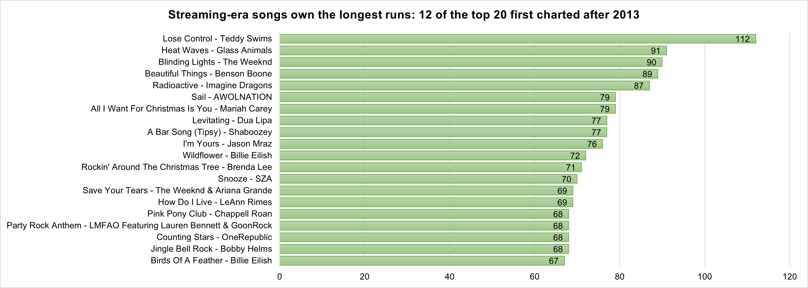
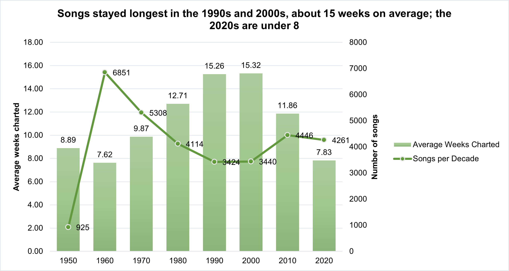
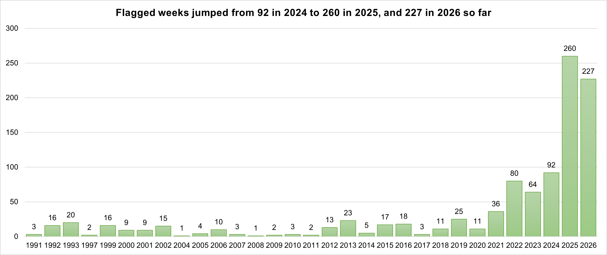
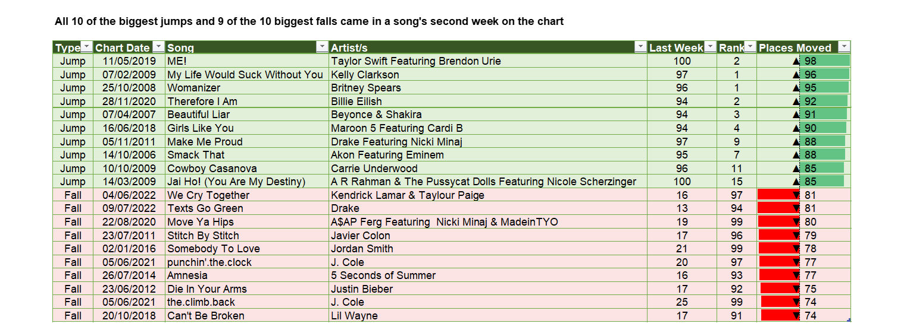
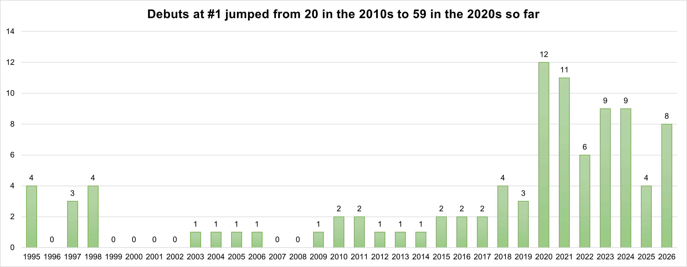

# Billboard Hot 100 — Full Chart History Analysis (Excel)

An Excel-only analysis of the **complete Billboard Hot 100 chart history** — every weekly chart from **August 4, 1958 to October 31, 2026** (3,562 charts, 356,200 rows). Built entirely with Power Query, the Data Model, PivotTables, slicers and formulas. Python was used only to collect the data.

---

## Project Context

This project sits next to my [Billboard Hot 100 Chart Tracker](https://github.com/jhnmrtnvlln/billboard-hot100-tracker), but answers a different question:

| | Chart Tracker | This project |
|---|---|---|
| Scope | Weekly tracking since December 2024 | The full official history, 1958 to 2026 |
| Metric | Custom points, entered weekly | Official chart data only (rank, last week, peak, weeks on chart) — no points |
| Tools | Python, Excel, Power BI (DAX) | Excel only — Power Query, Data Model, PivotTables |
| Goal | Publish a weekly chart | Find patterns in 68 years of chart data |

The full dataset is also published on Kaggle: [Billboard Hot 100 — Top 100 Singles (Full History)](https://www.kaggle.com/datasets/johnmartinvillena/billboard-hot-100-full-history).

---

## At a Glance

| Analysis | Finding |
|---|---|
| **Longest-charting songs** | "Lose Control" (Teddy Swims) ran **112 weeks**; **12 of the 20** longest runs began in the streaming era |
| **Average weeks per decade** | Songs lasted longest in the **1990s and 2000s (about 15 weeks)** and shortest in the **2020s (7.8)** |
| **Recurrent-rule bypass** | **1,001 chart weeks across 236 songs** sat below a recurrent cutoff, **487** of them in 2025–2026 |
| **Jumps and falls** | Biggest jump **98 places**, biggest fall **81**; nearly all came in a song's **second week** |
| **Debuts at #1** | **95 songs** have debuted at #1, **59** of them in the 2020s |

---

## Analysis 1 — Longest-Charting Songs



The 20 songs with the most weeks on the Hot 100. **"Lose Control" by Teddy Swims leads with 112 weeks**, followed by "Heat Waves" (91), "Blinding Lights" (90), "Beautiful Things" (89) and "Radioactive" (87).

- **12 of the 20** first charted from March 2, 2013 — when Billboard began counting YouTube views — yet songs from that period make up only about 22% of all songs.
- The list includes two holiday songs, "All I Want For Christmas Is You" (79) and "Rockin' Around The Christmas Tree" (71), which return every December.
- The workbook adds slicers for era and streaming phase, so the same chart can be filtered to one recurrent-rule era.
- Two songs tie at 67 weeks for 20th place: "Birds Of A Feather" and "I Had Some Help".

---

## Analysis 2 — Average Weeks on the Chart, by Decade



Each song is placed in the decade of its **first chart week**. The columns show the average weeks per song (left axis) and the line shows how many songs debuted in that decade (right axis).

- The average climbs from **8.9 weeks** in the 1950s, through a dip to **7.6** in the 1960s, to a peak of **15.3** in the 1990s and 2000s.
- It then falls to **11.9** in the 2010s and **7.8** in the 2020s, even though the longest individual runs belong to the streaming years. More songs come and go quickly, while a few stay for a very long time.
- The 1950s covers only August 1958 to December 1959, and the 2020s runs through October 2026, with some songs still on the chart.

---

## Analysis 3 — Recurrent-Rule Bypass



Billboard removes older songs from the Hot 100 using **recurrent rules**, which changed over time. A chart week is **flagged** when a song has *more* weeks on the chart than a rule allows *and* ranks *below* that rule's cutoff.

- **1,001 flagged weeks across 236 songs** since the first rule (chart dated November 30, 1991).
- Flagged weeks climb from 92 in 2024 to **260 in 2025** and **227 in 2026 so far** — 487 of the 1,001 total.
- Measured per chart, that is about **1 flagged week per 8 charts** in 1991–2014 and about **6 per chart** since the tiered rules began on October 25, 2025. The 2025 tiers are stricter, so part of the rise comes from the rules themselves.
- Years with no flagged weeks (1994–1996, 1998 and 2003) do not appear in the chart.
- The rules sit in a small `RecurrentRules` table with sources, and the 1992 cutoff dates were checked against the chart data: "O.P.P." at #37 in its 21st week on January 25, 1992, and "Finally" at #41 in its 29th week on April 11, 1992.

**These are candidates, not confirmed breaches.** The data has no airplay or points, and Billboard says songs below the cutoffs can stay on the chart case by case — for example, for radio growth, holiday songs, or older songs that surge back.

---

## Analysis 4 — Biggest Jumps and Falls



The ten biggest one-week rank jumps and falls, measured against last week's rank (new entries and re-entries are excluded).

- **Biggest jump: 98 places** — Taylor Swift's "ME!" went from #100 to #2 (May 11, 2019), ahead of Kelly Clarkson's "My Life Would Suck Without You" (+96) and Britney Spears' "Womanizer" (+95).
- **Biggest falls: 81 places** — Kendrick Lamar & Taylour Paige's "We Cry Together" (#16 to #97) and Drake's "Texts Go Green" (#13 to #94).
- **All 10 jumps and 9 of the 10 falls happened in the song's second week.** Songs often enter low in a partial first week and jump, or debut high and drop. The data shows when it happens, not why.

---

## Analysis 5 — Songs That Debuted at #1



**95 songs** entered the Hot 100 at #1, starting with Michael Jackson's "You Are Not Alone" on September 2, 1995.

- 11 debuted in the 1990s, 5 in the 2000s, **20 in the 2010s** and **59 in the 2020s** so far, peaking at 12 in 2020 and 11 in 2021.
- The very first chart (August 4, 1958) is excluded, since every song on it counts as week 1.
- Among these songs, the longest stays at #1 were:

| Song | Artist | Debut | Weeks at #1 | Total Weeks Charted |
|------|--------|-------|-------------|---------------------|
| One Sweet Day | Mariah Carey & Boyz II Men | Dec 2, 1995 | 16 | 27 |
| As It Was | Harry Styles | Apr 2, 2022 | 15 | 61 |
| Candle In The Wind 1997 | Elton John | Oct 11, 1997 | 14 | 42 |
| Shape Of You | Ed Sheeran | Jan 28, 2017 | 12 | 59 |
| God's Plan | Drake | Feb 3, 2018 | 11 | 36 |

Six of the 95 songs are still on the chart, so their totals can still grow.

---

## Overview

The project has three layers:

1. **`h100_history.csv`** — the data layer. One row per song per week, collected with a Python batch script using the `billboard.py` package. Columns: `chart_date`, `rank`, `title`, `artist`, `last_week`, `peak_pos`, `weeks_on_chart`. Points are not included, because Billboard does not publish them for older charts.
2. **`h100_analysis.xlsx`** — the analysis layer. Nine Power Query queries load the CSV into the Data Model, and PivotTables, charts and slicers sit on top of it. Sheets: `Overview`, five analysis sheets, `Checks` (validation of the loaded data) and `Data Notes` (sources, cleaning steps and quirks).
3. **`power_query_code.txt`** — all nine queries in readable text, so the cleaning and analysis logic can be reviewed without opening Excel.

As of **October 31, 2026**, the data covers **3,562 charts** and **32,769 distinct songs**.

---

## How It Works

**Data preparation (Power Query):**
- The CSV path lives in a single `FilePath` parameter, so the workbook can be pointed at a new location in one place.
- Dates are read with the `en-GB` culture (dd/mm/yyyy), `rank` and `weeks_on_chart` become numbers, and the `-` in `last_week` (a new entry) becomes a blank.
- A `ChartDates` table is built from the distinct chart dates, so "weeks" always means charts, not calendar weeks. This matters because three charts have irregular dates (see the note on the data below).
- A `Songs` table groups the chart rows into one row per song, with total weeks charted, first and last chart date, and peak rank.

**Data Model:**
`Charts` (356,200 rows) is related to `ChartDates` (3,562 rows) on `chart_date`, so year and decade can be used as PivotTable fields on the chart data.

**Eras (Analysis 1):**
Eras follow Billboard's recurrent rules, and each song takes the era of its first chart week. A separate `streaming_phase` column marks songs that first charted before or from March 2, 2013.

| Era | Chart dates | Recurrent rule |
|---|---|---|
| 1. No recurrent rule | Aug 4, 1958 – Nov 23, 1991 | None |
| 2. 20-week rule | Nov 30, 1991 – Nov 28, 2015 | Removed after 20 weeks below a cutoff of #20, then #40, then #50 |
| 3. 52-week rule | Dec 5, 2015 – Oct 18, 2025 | Adds 52 weeks / below #25 |
| 4. Tiered rules | From Oct 25, 2025 | 20 weeks / #50, 26 / #25, 52 / #10, 78 / #5 |

**Recurrent-rule bypass (Analysis 3):**
The `BypassWeeks` query checks every chart row against the rules table and keeps the ones that break a rule. If several tiers apply, the strictest is kept.

```m
Match = Table.AddColumn(Candidates, "rule_hit", (r) =>
    List.Last(List.Select(Rules, (t) =>
        t[effective_from] <= r[chart_date] and r[chart_date] <= t[effective_to]
        and r[weeks_on_chart] > t[min_weeks] and r[rank] > t[cutoff_rank]), null))
```

**Excel features used:** Power Query (M), the Data Model with relationships, PivotTables and PivotCharts, slicers, `COUNTIFS`, `GETPIVOTDATA`, `HYPERLINK`, and conditional formatting (data bars, rule-based row shading and custom number formats).

---

## Files in This Repository

| File | Description |
|------|-------------|
| `h100_history.csv` | Complete weekly chart history, one row per song per week (356,200 rows) |
| `h100_analysis.xlsx` | The analysis workbook — open in Excel (Power Query and Data Model required) |
| `power_query_code.txt` | All nine Power Query queries, in the order they should be created |
| `longest-songs.png`, `avg-weeks.png`, `flagged-weeks.png`, `jumps-falls.png`, `number-one-debuts.png` | Charts and tables from the workbook, shown in this README |

To refresh the workbook, put `h100_history.csv` in a folder of your choice and update the `FilePath` parameter in Power Query.

---

## A Note on the Data and Its Limits

- **Ties:** in 1958–1989, 24 charts have two songs sharing a rank, so rank alone does not identify a row.
- **Irregular dates:** three charts break the weekly pattern — January 6, 1962 (a schedule realignment), July 4, 1976 (the US Bicentennial) and January 3, 2018 (a one-time mid-week chart). A year therefore has 52 or 53 charts.
- **First chart:** every song on the very first chart (August 4, 1958) counts as week 1, so it is excluded from the "debuted at #1" analysis.
- **Credits as printed:** titles and artists are kept exactly as Billboard credited them, so a credit change can split one song in two, and some titles combine more than one recording (for example "Unchained Melody" in 1990).
- **No points or airplay:** flagged weeks in the recurrent-rule analysis are *candidates*, not confirmed breaches.
- **Incomplete runs:** songs still on the latest chart, including the whole newest era, can still add weeks.

The full list of sources, cleaning steps and rule dates is in the `Data Notes` sheet.

---

## Data Source and Disclaimer

The chart data belongs to Billboard. This project is not affiliated with or endorsed by Billboard, and the data is shared for research and learning.

Rule sources:
- [Talk of the Charts — The Hot 100's Recurrent Rules, Explained](https://talkofthecharts.org/chart-notes/hot-100-recurrent-rules-guide)
- [Billboard — Older Hits Will Now Drop Off the Hot 100 (Gary Trust)](https://billboard.substack.com/p/older-hits-will-now-drop-off-the)

---

## Tools Used

- **Python** — one-time collection of the chart history (`billboard.py` package)
- **Microsoft Excel** — Power Query (M) for cleaning and modelling, the Data Model for relationships, PivotTables and PivotCharts for analysis, slicers, worksheet formulas and conditional formatting

---

## About

Built by **John Martin S. Villena**, BS Information Technology graduate (Business Analytics) from Bulacan State University.

🔗 [LinkedIn](https://www.linkedin.com/in/jhnmrtnvlln/)
📺 [YouTube](https://www.youtube.com/@TheTop50Singles)
🐦 [Twitter/X](https://x.com/TheTop50Singles)
💻 [GitHub](https://github.com/jhnmrtnvlln)
